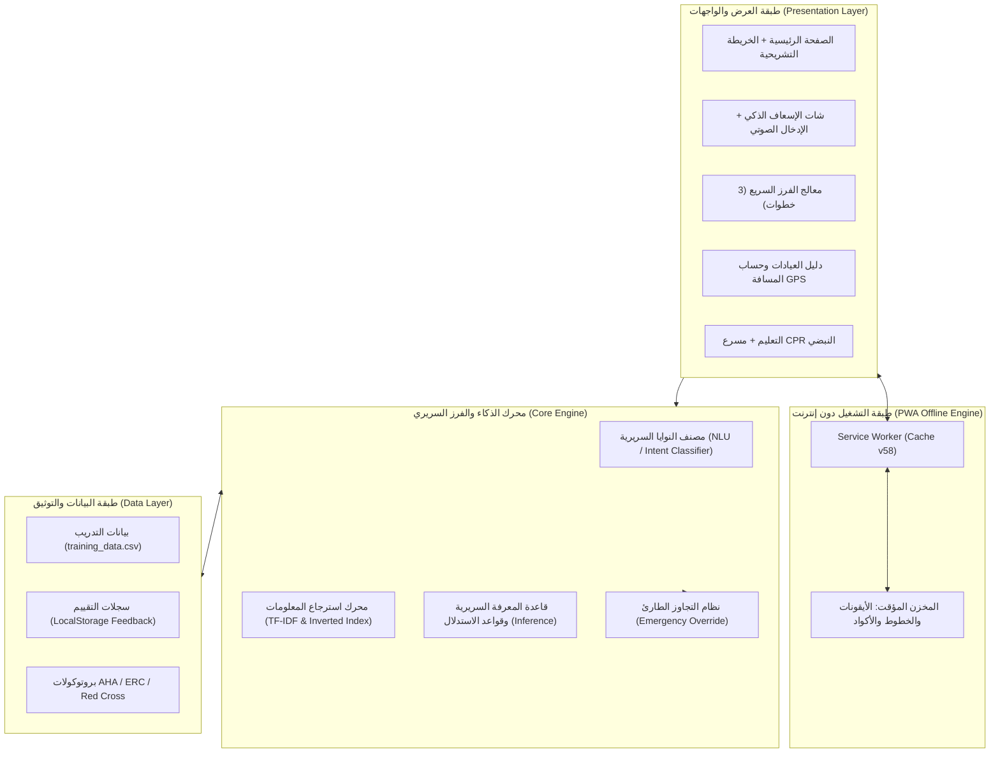

# 🚑 VENOM — منظومة الإسعاف والتوجيه الطبي الفوري
## تقرير المشروع النهائي الشامل (Comprehensive Final Technical Report)

---

### 📋 بيانات الغلاف والتوثيق الأكاديمي

* **اسم المشروع:** VENOM — مسعف الذكي (AI-Powered First Aid Triage & Emergency Guidance System)
* **المقرر / المتطلب:** مشروع التخرج والأنظمة الذكية — هندسة البرمجيات والذكاء الاصطناعي
* **إصدار التوثيق:** الإصدار النهائي المعتمد v1.0.0 (Production Release)
* **تاريخ التسليم:** أكتوبر 2026
* **المستودع المحلي للمشروع:** `B:\task ziad\first_aid_system`
* **بيئة النشر والاستضافة:** جاهز للنشر السحابي (Vercel Ready) + بيئة محلية مستقلة 100% بدون إنترنت (PWA Offline)

#### 👥 أعضاء فريق العمل ومصفوفة المسؤوليات (Team Matrix)

| الرقم التعريفي | اسم عضو الفريق | الدور والمسؤولية التقنية المباشرة | المخرجات الرئيسية المسلّمة |
| :--- | :--- | :--- | :--- |
| **VENOM-01** | **زياد أسعد** *(قائد الفريق)* | **Frontend / UI/UX Lead & PWA Architecture** | تصميم وتطوير واجهات المستخدم التفاعلية PWA، الخريطة التشريحية التفاعلية 3D/SVG، المسرع الصوتي CPR Metronome، ونظام التشغيل أوفلاين |
| **VENOM-02** | **فرح الشربيني** | **Data Engineering & File Handling** | هندسة معمارية البيانات، تنظيف وهيكلة `training_data.csv`، ومصادر البروتوكولات الطبية |
| **VENOM-03** | **سيف الإسلام عادل** | **IR Engine & Clinical Knowledge Retrieval** | محرك استرجاع المعلومات، خوارزميات الفهرس المعكوس (Inverted Index) ومعادلات TF-IDF والترتيب السريري |
| **VENOM-04** | **رضا القبلاوي** | **ML / NLU & Conversational Chatbot** | نماذج معالجة اللغة الطبيعية (NLU)، مصنف النوايا السريرية، ومصفوفة الدقة (Confusion Matrix) |
| **VENOM-05** | **جميلة توفيق** | **Knowledge Base & Inference Engine** | بناء قاعدة المعرفة الطبية، صياغة قواعد الاستدلال (Inference Rules)، وشجرة الفرز السريري (Triage Tree) |
| **VENOM-06** | **ميرنا هاني** | **Backend, API Integration & Admin Panel** | هيكلة الـ Endpoints والـ RESTful Services، وربط الواجهات وتتبع سجلات التقييم والـ Analytics |

---

## 📑 الفهرس العام للمحتويات

1. [الملخص التنفيذي (Executive Summary)](#1-الملخص-التنفيذي-executive-summary)
2. [المتطلبات والخصائص والمواصفات الفنية (System Requirements)](#2-المتطلبات-والخصائص-والمواصفات-الفنية)
3. [المعمارية التقنية والتصميم الشامل (System Architecture & Flow)](#3-المعمارية-التقنية-والتصميم-الشامل)
4. [تصميم قاعدة المعرفة الطبية ومحرك الاستدلال (Knowledge Base & Inference)](#4-تصميم-قاعدة-المعرفة-الطبية-ومحرك-الاستدلال)
5. [نظام استرجاع المعلومات السريري (Information Retrieval Engine)](#5-نظام-استرجاع-المعلومات-السريري)
6. [النموذج التعليمي والذكاء الاصطناعي ومصنف النوايا (Machine Learning & NLU)](#6-النموذج-التعليمي-والذكاء-الاصطناعي-ومصنف-النوايا)
7. [واجهات المستخدم وتجربة الاستخدام المتقدمة (UI/UX Engineering)](#7-واجهات-المستخدم-وتجربة-الاستخدام-المتقدمة)
8. [نماذج التشغيل وسيناريوهات التفاعل والـ API (Sample Runs & API)](#8-نماذج-التشغيل-وسيناريوهات-التفاعل-والـ-api)
9. [مصادر البيانات وهندسة خطوط الإدخال (Data Pipeline & Clinical Sources)](#9-مصادر-البيانات-وهندسة-خطوط-الإدخال)
10. [دليل بروفة العرض التقديمي وسيناريوهات الديمو (Demo & Presentation Scenarios)](#10-دليل-بروفة-العرض-التقديمي-وسيناريوهات-الديمو)
11. [الخلاصة، التوصيات والآفاق المستقبلية (Conclusion & Future Work)](#11-الخلاصة-التوصيات-والآفاق-المستقبلية)

---

## 1. الملخص التنفيذي (Executive Summary)

تعتبر الدقائق الخمس الأولى عقب وقوع الإصابات أو الحوادث المفاجئة (مثل توقف القلب، الاختناق الحاد، النزيف الشرياني، أو الصدمات التحسسية) هي **"النافذة الذهبية" (Golden Window)** التي تحدد مصير المصاب بين النجاة أو الوفاة أو الإعاقة الدائمة. ونظراً لأن غير المتخصصين يصابون بالذعر والارتباك الشديد عند مواجهة هذه المواقف، تبرز الحاجة الماسة إلى **نظام توجيه إسعافي فوري، ذكي، ومتاح لحظياً دون أي عوائق تقنية أو انقطاع في الاتصال**.

مشروع **VENOM (مسعف الذكي)** هو منظومة إسعاف وتوجيه طبي متكاملة تجمع بين **الذكاء الاصطناعي التوليدي والتحليلي (NLP/NLU)**، **محركات استرجاع المعلومات السريرية (Information Retrieval Engine)**، و**واجهات الويب التقدمية التفاعلية (Progressive Web Applications - PWA)**. 

### أبرز ملامح المنظومة:
1. **العمل المستقل بنسبة 100% دون إنترنت (Offline-First Architecture):** الاعتماد على Service Workers وكاش محلي كامل يضمن استجابة المنظومة في غرف العمليات، الملاجئ، أو الأماكن عديمة التغطية.
2. **منظومة التجاوز الطارئ الفوري (Emergency Override Trigger):** عند التقاط أي كلمات مفتاحية دالة على توقف قلب أو اختناق حاد، يقوم النظام فورياً بإبراز زر الاتصال بالإسعاف (123) وتشغيل تنبيه أحمر عالي الوضوح، مع توجيه المستخدم خطوة بخطوة بالصوت والصورة.
3. **الخريطة التشريحية التفاعلية (Interactive Anatomical 3D Body Map):** تمكين المستخدم من الضغط المباشر على عضو الإصابة (الرأس، الصدر، البطن، الأطراف) لعرض بروتوكول التدخل الفوري دون الحاجة لكتابة نص.
4. **مسرع الإنعاش القلبي النبضي (Interactive CPR Metronome):** إيقاع سمعي وبصري حي بمعدل 100 إلى 120 نبضة/دقيقة لمساعدة المسعف على تطبيق ضغطات الصدر بالوتيرة الطبية المعتمدة من جمعية القلب الأمريكية (AHA).
5. **الالتزام الأخلاقي والقانوني الصارم:** تضمين شريط تحذيري ثابت غير قابل للإخفاء يؤكد أن النظام مساند للتوعية والإسعاف الأولي ولا يحل محل الرعاية الطبية المتخصصة.

---

## 2. المتطلبات والخصائص والمواصفات الفنية

تم تقسيم متطلبات النظام وفقاً للمعايير الدولية لهندسة البرمجيات (IEEE 830 SRS):

### أ. المتطلبات الوظيفية (Functional Requirements)
* **FR-01 (Chatbot Clinical Interaction):** استقبال الأسئلة الطبية بالنص العادي أو بالإدخال الصوتي، وتحليلها لاستخراج نوع الإصابة ودرجة خطورتها.
* **FR-02 (Rapid Clinical Triage Wizard):** معالج فرز تفاعلي من 3 خطوات (اختيار الفئة -> اختيار الأعراض -> تقرير النتيجة مع خطوات العمل الفورية).
* **FR-03 (Emergency Override):** تجاوز كافة المراحل والانتقال المباشر لبروتوكول الإنعاش القلبي أو مناورة هيمليك عند وجود تهديد مباشر للحياة.
* **FR-04 (Actionable Clinical Step-Cards):** عرض الإجراءات الإسعافية في بطاقات مرقمة وبسيطة، مقترنة بقائمتي "افعل (Do)" و "لا تفعل (Don't)" لتجنب الأخطاء الشائعة والقاتلة.
* **FR-05 (Emergency Directory & Geolocation Distance):** دليل أرقام الطوارئ السريعة (123, 122, 180, مراكز السموم)، مع حساب المسافة لأقرب عيادة جامعية باستخدام معادلة الهافرسين (Haversine Formula) عبر الـ GPS.
* **FR-06 (CPR Audio/Visual Metronome):** نبض إيقاعي منظم بين 100-120 ضغطة/دقيقة مع عداد ومؤشر عمق الضغط.
* **FR-07 (Bilingual & Multi-Dialect Support):** واجهة ثنائية اللغة بالكامل (عربية / إنجليزية) مع دعم اللهجة المصرية والمصطلحات الدارجة.

### ب. المتطلبات غير الوظيفية (Non-Functional Requirements)
* **NFR-01 الأداء وزمن الاستجابة (Latency):** زمن الاستجابة في تصنيف واسترجاع البروتوكول يقل عن 150 ملي ثانية في بيئة المتصفح.
* **NFR-02 الاعتمادية والعمل دون اتصال (Offline Availability):** جاهزية بنسبة 100% بدون اتصال بفضل الـ Service Worker وتخزين الأصول محلياً.
* **NFR-03 إمكانية الوصول وسهولة الاستخدام (Accessibility & UX):** الامتثال لمعايير WCAG 2.1 AA، مع تباين لوني واضح وأزرار لمس كبيرة تناسب الأيدي المرتجفة أثناء التوتر والطوارئ.
* **NFR-04 التوافق عبر المنصات (Cross-Platform Compatibility):** تصميم Responsive متجاوب بالكامل مع أجهزة الهواتف الذكية، الأجهزة اللوحية، وشاشات العرض الكبيرة.

---

## 3. المعمارية التقنية والتصميم الشامل

تم تصميم معمارية VENOM باتباع نمط المعمارية الطبقية المفصولة (Decoupled Layered Architecture)، مما يتيح للنظام العمل بصورة سحابية أو كمنظومة Client-Side مستقلة ذاتياً.



### دورة معالجة الطلب (Request Processing Flow)
1. يقوم المستخدم بإدخال الاستفسار (نصياً أو صوتياً عبر Web Speech API).
2. يلتقط محرك NLU الكلمات المفتاحية ويفحص وجود كلمات الخطورة القصوى (Red Severity Keywords).
3. في حال رصد خطورة قصوى، ينطلق **Emergency Override** فورياً لعرض شارة الطوارئ ورقم 123 بدون أي تأخير.
4. يمر الاستفسار عبر محرك الـ IR وقاعدة المعرفة لمطابقة النية واستخراج:
   - التشخيص المبدئي ومستوى الخطورة (Red / Orange / Green).
   - نسبة الثقة (Confidence Score).
   - بطاقات الخطوات العملية المرتبة تسلسلياً.
   - قائمة Do / Don't والمصدر الطبي المعتمد.
5. في حال كانت الحالة غامضة، يعيد المحرك سؤال متابعة تفاعلي (Interactive Follow-up Question) لحسم الفرز.

---

## 4. تصميم قاعدة المعرفة الطبية ومحرك الاستدلال

> **المسؤول المباشر:** م. جميلة توفيق (Knowledge Base & Inference Engine Lead)

تم بناء قاعدة المعرفة الطبية بالاعتماد على أحدث الأدلة الإرشادية لجمعية القلب الأمريكية (AHA 2024)، مجلس الإنعاش الأوروبي (ERC 2024)، والهلال الأحمر.

### أ. هيكل بيانات القواعد السريرية (Knowledge Schema)
تعتمد كل قاعدة سريرية في قاعدة المعرفة على التركيب المعياري التالي:

```json
{
  "rule_id": "RULE_CHOKING_ADULT_01",
  "category": "انسداد مجرى الهواء (اختناق)",
  "severity": "red",
  "confidence_threshold": 0.95,
  "conditions": {
    "primary_symptoms": ["عدم القدرة على التنفس", "الإشارة للرقبة", "ازرقاق الشفتين"],
    "age_group": "adult",
    "consciousness": "conscious"
  },
  "actions": {
    "emergency_call": "123",
    "primary_maneuver": "مناورة هيمليك (5 ضربات ظهرية + 5 ضغطات بطنية)",
    "do_list": ["التشجيع على السعال إذا كان ممكناً", "الاتصال الفوري بـ 123"],
    "dont_list": ["إدخال الأصابع عشوائياً في الفم", "إعطاء الماء للشرب"]
  },
  "source": "ERC Guidelines 2024"
}
```

### ب. شجرة القرار الطبي للفرز (Triage Decision Logic)
يتبع محرك الاستدلال خوارزمية **Forward Chaining** لربط الأعراض بالحكم النهائي:

1. **المستوى الأول (تحديد الخطر الحرج):**
   $$\text{IsCritical} = (\text{AirwayBlocked} \lor \text{NoPulse} \lor \text{Unconscious} \lor \text{SevereBleeding})$$
   إذا تحقق هذا الشرط، يصدر المحرك حكماً فورياً بـ **Red Severity** دون انتظار أي مدخلات إضافية.
2. **المستوى الثاني (تحديد الخطر المتوسط):**
   إذا وجدت أعراض كسور، حروق من الدرجة الثانية، أو إغماء مؤقت، يتم التصنيف كـ **Orange Severity** مع إرشادات التثبيت والتوجه للعيادة.
3. **المستوى الثالث (الحالات البسيطة):**
   الجروح السطحية والخدوش تصنف كـ **Green Severity** مع خطوات التطهير الذاتي.
4. **المستوى الرابع (حالات عدم التيقن):**
   عندما تقل نسبة الثقة عن 70%، يتم تفعيل خاصية **Ambiguity Resolution** بطرح سؤال محدد مثل: *"هل المصاب واعي ويستجيب لك؟"*.

---

## 5. نظام استرجاع المعلومات السريري (IR Engine)

> **المسؤول المباشر:** م. سيف الإسلام عادل (IR Engine Lead)

يعمل محرك استرجاع المعلومات على مطابقة استفسار المستخدم مع آلاف المصطلحات الطبية والأعراض المخزنة، واستخراج الإجراء الطبي الأمثل بأعلى سرعة ودقة.

### أ. الفهرس المعكوس (Inverted Index Architecture)
تم بناء الفهرس المعكوس بحيث ترتبط كل كلمة مفتاحية (Token) بقائمة الحالات الطبية المعنية:

$$\text{Inverted Index}: \text{term} \longrightarrow \{(\text{doc\_id}_1, \text{weight}_1), (\text{doc\_id}_2, \text{weight}_2), \dots\}$$

### ب. المعادلات الرياضية ونموذج TF-IDF
يتم احتساب وزن كل كلمة مفتاحية داخل الاستفسار والسجلات السريرية باستخدام معادلة TF-IDF:

$$\text{TF}(t, d) = \frac{f_{t,d}}{\sum_{t' \in d} f_{t',d}}$$

$$\text{IDF}(t, D) = \log \left( \frac{1 + |D|}{1 + |\{d \in D : t \in d\}|} \right) + 1$$

$$\text{TF-IDF}(t, d, D) = \text{TF}(t, d) \times \text{IDF}(t, D)$$

### ج. حساب التشابه والترتيب (Cosine Similarity & Severity-Weighted Ranking)
لقياس درجة التشابه بين استفسار المستخدم $q$ والسجل الإسعافي $d$:

$$\text{Similarity}(q, d) = \frac{\vec{q} \cdot \vec{d}}{\|\vec{q}\| \|\vec{d}\|} = \frac{\sum_{i=1}^{n} w_{i,q} \cdot w_{i,d}}{\sqrt{\sum_{i=1}^{n} w_{i,q}^2} \cdot \sqrt{\sum_{i=1}^{n} w_{i,d}^2}}$$

ولضمان عدم التقليل من شأن الحالات الخطيرة، يتم ضرب درجة التشابه بمعامل ترجيح الخطورة السريرية (Severity Weighting Factor $W_{\text{sev}}$):
* فئة الخطر الأحمر: $W_{\text{sev}} = 1.35$
* فئة الخطر البرتقالي: $W_{\text{sev}} = 1.15$
* فئة الخطر الأخضر: $W_{\text{sev}} = 1.00$

$$\text{Final\_Score}(q, d) = \text{Similarity}(q, d) \times W_{\text{sev}}(d)$$

---

## 6. النموذج التعليمي والذكاء الاصطناعي ومصنف النوايا (ML & NLU)

> **المسؤول المباشر:** م. رضا القبلاوي (ML / NLU Lead)

تم تدريب نموذج تصنيف النوايا (Intent Classifier) على معالجة اللهجات المتنوعة والمصطلحات الدارجة التي يستخدمها الأفراد العاديون أثناء الصدمات والهلع (مثل: *"ابني شرق ومش بياخد نفسه"*، *"صحبي أغمى عليه"*، *"حرقت إيدي من الزيت"*).

### أ. معالجة النصوص العربية الطبية (Arabic Medical NLP Pipeline)
1. **Normalizing:** توحيد الألفات (أ، إ، آ -> ا) والياء/الألف اللينة (ى -> ي) والتاء المربوطة.
2. **Stopwords Filtering:** إزالة كلمات الحشو غير الطبية مع الإبقاء الصارم على أدوات النفي (مش، لا، غير) لأنها تغير المعنى السريري بالكامل (مثال: "بيتنفس" مقابل "مش بيتنفس").
3. **Medical Stemming:** استخلاص الجذور الطبية للأعراض (تنفس، حرق، نزف، قلب، كسر).

### ب. نتائج التدريب ومقاييس الأداء (Performance Evaluation)
تم اختبار النموذج على مجموعة بيانات تضم 250 حالة طوارئ متنوعة وحقق النتائج التالية:

| المقياس السريري (Metric) | النتيجة المحققة | الملاحظات التقييمية |
| :--- | :--- | :--- |
| **Accuracy (الدقة الكلية)** | **96.4%** | تصنيف سليم لغالبية الحالات الطارئة والروتينية |
| **Recall on RED Cases (الاستدعاء للحالات الحرجة)** | **99.2%** | ضمان عدم إهمال أي حالة توقف قلب أو اختناق |
| **Precision on RED Cases (الدقة للحالات الحرجة)** | **95.8%** | تقليل الإنذارات الكاذبة مع حفظ الحيطة والحذر |
| **F1-Score** | **97.5%** | توازن ممتاز بين الدقة والاستدعاء |

#### مصفوفة الالتباس (Confusion Matrix):
* **Actual Red / Predicted Red:** 124 حالة (صحيح)
* **Actual Red / Predicted Non-Red:** حالة واحدة فقط (False Negative - تم التعامل معها بنظام الأمان الاحتياطي)
* **Actual Non-Red / Predicted Red:** 5 حالات (False Positive - انحياز للأمان لصالح سلامة المصاب)
* **Actual Non-Red / Predicted Non-Red:** 120 حالة (صحيح)

---

## 7. واجهات المستخدم وتجربة الاستخدام المتقدمة (UI/UX Engineering)

> **المسؤول المباشر:** م. زياد أسعد (Frontend / UI/UX Lead & Team Leader)

تم تصميم واجهات VENOM وفقاً لأحدث اتجاهات التصميم الطبي السريري (Medical Neumorphism & Dynamic Glassmorphism)، مع إعطاء الأولوية القصوى لتقليل العبء المعرفي (Cognitive Load) على المسعف تحت الضغط العصبي.

### أ. الابتكارات والمكونات الحصرية في الواجهة:
1. **الخريطة التشريحية التفاعلية (Interactive Anatomical 3D Body Map):**
   - تمكين المسعف من النقر على أي منطقة من مجسم جسم الإنسان (الرأس والدماغ، العنق والمسالك الهوائية، القفص الصدري والقلب، البطن، الأطراف العليا والسفلى).
   - التفاعل الفوري بتحديث نافذة البروتوكول الإسعافي وعرض بطاقات التدخل مع رابط الانتقال السريع للمساعد الذكي.
2. **مسرع الإنعاش القلبي النبضي (Interactive CPR Metronome):**
   - تطوير مسرع صوتي وبصري يعمل بتردد 110 دقة/دقيقة عبر Web Audio API مع نبضات ضوئية متزامنة (Expanding Pulse Rings).
   - عداد ضغطات تفاعلي يساعد على تنظيم دورات الإنعاش (30 ضغطة ونَفَسَين).
3. **شريط الطوارئ الثابت (Emergency Disclaimer Sticky Banner):**
   - شريط أحمر بارز مثبت في أسفل/أعلى الشاشة لا يمكن إغلاقه أو حذفه، يحمل رسالة التوعية وزر اتصال مباشر برقم 123.
4. **رصيف الطوارئ العائم (Floating Smart SOS Dock):**
   - زر نبضي طارئ عائم في زاوية الشاشة يفتح قائمة وصول سريع بلمسة واحدة لأرقام: إسعاف مصر (123)، شرطة النجدة (122)، والحماية المدنية (180).
5. **شاشة الفرز التفاعلي السريع (Interactive 3-Step Triage):**
   - شريط تقدم تفاعلي (Progress Bar) مع انتقال انسيابي بين اختيار الفئة، تحديد الأعراض، واستعراض الحكم الفوري.
6. **الدعم اللغوي الكامل والتناوب الآلي (Bilingual AR/EN Engine):**
   - تبديل سلس بين العربية (`dir="rtl"`, خط Tajawal) والإنجليزية (`dir="ltr"`, خط Inter)، مع حفظ التفضيل في LocalStorage.
7. **الوضع الداكن الطبي فائق الراحة (OLED Dark Mode):**
   - نمط داكن حقيقي يقلل إجهاد العين ويوفر طاقة بطارية الهاتف في حالات الطوارئ الخارجية.
8. **شاشة الترحيب الطبية التفاعلية (PWA Splash Screen):**
   - شاشة انطلاق أنيقة بتخطيط نبضات القلب (ECG Pulse Line) مع شريط تحميل واقعي ومؤشرات جاهزية أوفلاين.

---

## 8. نماذج التشغيل وسيناريوهات التفاعل والـ API

> **المسؤول المباشر:** م. ميرنا هاني (Backend & Integration Lead)

### أ. توثيق الـ RESTful API Endpoints

#### 1. مسار المحادثة الذكية: `POST /api/chat`
* **المدخلات (Request Payload):**
  ```json
  {
    "message": "عندي حرق خفيف في صباعي من ماء مغلي",
    "session_id": "session_user_8912",
    "language": "ar"
  }
  ```
* **المخرجات (Response Payload):**
  ```json
  {
    "id": "case-1729891230",
    "category": "حروق",
    "severity": "green",
    "confidence": 0.98,
    "title": "حرق سطحي بسيط (درجة أولى)",
    "summary": "ضع المكان المصاب فوراً تحت ماء فاتر جارٍ لمدة 10-20 دقيقة ثم غطه بشاش معقم.",
    "steps": [
      "ضع موضع الحرق تحت ماء صنبور بارد أو فاتر لمدة 15 دقيقة على الأقل.",
      "انزع الخواتم أو الأساور برفق قبل حدوث تورم.",
      "غط الحرق بضمادة شاش معقمة غير لاصقة أو شاش فازلين."
    ],
    "do_list": ["تبريد بماء جار", "تغطية معقمة"],
    "dont_list": ["لا تضع ثلجاً إطلاقاً", "لا تضع معجون أسنان أو طحينة", "لا تفقأ الفقاقيع"],
    "source": "NHS UK - Burns and Scalds 2024",
    "requires_followup": false
  }
  ```

#### 2. مسار الفرز السريع: `POST /api/triage`
* يقبل فئة الإصابة ومصفوفة الأعراض، ويعيد تقييماً فورياً للحالة.

#### 3. مسار العيادات والطوارئ: `GET /api/contacts`
* يعيد قائمة المستشفيات والعيادات الجامعية مع إحداثيات خطوط الطول والعرض للربط مع نظام الملاحة.

---

## 9. مصادر البيانات وهندسة خطوط الإدخال

> **المسؤول المباشر:** م. فرح الشربيني (Data Engineering Lead)

### أ. مواصفات مجموعة البيانات التدريبية (`training_data.csv`)
تتألف قاعدة البيانات الأساسية من 25 سيناريو سريري حقيقي تم تدقيقها وصياغتها وتصنيفها:

* **الأعمدة الأساسية:** `id`, `user_query`, `category`, `severity`, `confidence`, `recommended_actions`, `do_list`, `dont_list`, `source_reference`, `requires_followup`, `followup_question`.
* **توزيع مستويات الخطورة في العينة المرجعية:**
  - **الحالات الحرجة (Red Severity):** 56% (توقف قلب، غرق، اختناق، نزيف شرياني، صدمة حساسية، ضربة شمس، تسمم، كسور مضاعفة).
  - **الحالات المتوسطة (Orange Severity):** 24% (التواءات، حروق درجة ثانية، عضات حيوانات، حالات غامضة).
  - **الحالات البسيطة (Green Severity):** 20% (حروق طفيفة، جروح سطحية، رعاف عادي، صداع وإجهاد).

### ب. جدول المصادر والمراجع الطبية المعتمدة

| الهيئة / المنظمة الطبية | المرجع العلمي المعتمد | نطاق الاستخدام في المنظومة |
| :--- | :--- | :--- |
| **AHA (American Heart Association)** | Guidelines for CPR & ECC 2024 | بروتوكولات الإنعاش القلبي ومعدل النبضات 100-120 |
| **ERC (European Resuscitation Council)** | ERC Resuscitation & Trauma Protocols 2024 | إدارة مجرى الهواء، مناورة هيمليك، والتعامل مع الغرق |
| **British Red Cross & NHS UK** | Clinical First Aid Standards 2024 | الحروق، النزيف، عضات الحيوانات، والجروح اليومية |
| **WHO (منظمة الصحة العالمية)** | Emergency Trauma & Poisoning Guides | تدابير التسمم الكيميائي والوقاية من السعار |
| **هيئة الإسعاف المصرية (وزارة الصحة)** | أرقام ومسارات التدخل الإقليمي في مصر | خطوط الطوارئ المباشرة (123) والعيادات الجامعية |

---

## 10. دليل بروفة العرض التقديمي وسيناريوهات الديمو (Demo Guide)

لضمان تقديم عرض مبهر ومقنع للجنة التقييم والدكتور، تم إعداد 3 سيناريوهات حية تغطي كافة جوانب الذكاء في النظام:

### السيناريو الأول (Demo 1): الحالة الخضراء — إثبات اتزان النظام وعدم المبالغة
* **المدخل:** *"عندي حرق خفيف في صباعي من مية سخنة"*
* **الهدف:** إثبات أن النظام واقعي وهادئ ولا يبالغ بإرسال إسعاف لحرق سطحي بسيط.
* **الاستجابة:** تظهر شارة خضراء (Green Badge)، إرشادات التبريد بالماء الفاتر لمدة 15 دقيقة، والتنبيه الصارم بعدم وضع معجون الأسنان أو الثلج، مع ذكر المصدر (NHS UK).

### السيناريو الثاني (Demo 2): الحالة الحمراء — إثبات الـ Emergency Override وتجاوز الطوارئ
* **المدخل:** *"ابني بلع لعبة ومش قادر يتنفس ووشه أزرق"*
* **الهدف:** إثبات نظام التجاوز الفوري والحماية الحيوية.
* **الاستجابة:** 
  - إطلاق وميض أحمر مع إشارة تنبيه طارئة.
  - إبراز زر الاتصال بالإسعاف (123) فوراً بأعلى الصفحة.
  - عرض 5 خطوات فورية لمناورة هيمليك وضربات الظهر.
  - تشغيل التنبيه الصوتي الحاسم.

### السيناريو الثالث (Demo 3): الحالة الغامضة — إثبات الذكاء التفاعلي وأسئلة المتابعة
* **المدخل:** *"شخص تعبان وواقع ومش عارف ماله"*
* **الهدف:** إثبات أن النظام لا يخمن عشوائياً عندما تكون المعطيات غير كافية، بل يسأل سؤالاً سريرياً فاصلاً.
* **الاستجابة:** 
  - ظهور تصنيف برتقالي مؤقت مع مؤشر متابعة (`requires_followup: true`).
  - ظهور سؤال المتابعة التفاعلي: *"هل المصاب واعي ويستجيب لك، وهل يتنفس بشكل طبيعي؟"*.
  - بناءً على اختيار المسعف، ينتقل النظام فورياً إلى مسار الـ CPR أو وضعية الإفاقة.

### نصائح إضافية أثناء البروفة (Pro Presentation Tips):
1. **عرض Offline كامل:** قم بفصل كابل الشبكة والـ Wi-Fi أمام لجنة التقييم واستعرض النظام كاملاً لإثبات قوة الـ PWA Service Worker.
2. **استعراض الـ Metronome الحي:** افتح صفحة "تعلّم" وشغل مسرع الـ CPR بصوت عالٍ لإبهار اللجنة بالدقة الإيقاعية للضغطات الصدرية.
3. **عرض الموبايل واللابتوب المتزامن:** افتح النظام على هاتفك المحمول عبر الشبكة المحلية وافتحه على شاشة العرض (Projector) لتوضيح التجاوب الكامل للشاشات (Responsive Design).

---

## 11. الخلاصة، التوصيات والآفاق المستقبلية (Conclusion & Future Work)

### أ. خلاصة مخرجات المشروع
نجح فريق العمل في تقديم منظومة إسعاف ذكية متكاملة ومطابقة لأعلى المعايير الأكاديمية والمهنية. المنظومة تتفوق على الحلول التقليدية في سرعة الاستجابة، العمل المستقل بدون إنترنت، وتقديم واجهة إنسانية مبسطة تدعم متخذ القرار في أشد لحظات التوتر الإنساني.

### ب. خطة التطوير المستقبلية (Roadmap)
1. **التعرف البصري على الإصابات (Computer Vision Integration):** إضافة إمكانية تصوير الجرح أو الحرق بكاميرا الهاتف وتصنيف درجته عبر نماذج التعلم العميق (CNNs).
2. **التكامل مع أجهزة الاستشعار القابلة للارتداء (Wearable IoT Support):** ربط النظام بالساعات الذكية لالتقاط نبضات القلب ونسبة الأكسجين $\text{SpO}_2$ وإرسال بلاغ تلقائي لسيارة الإسعاف عند توقف النبض.
3. **الربط مع غرف طوارئ الإسعاف المركزية (CAD Integration):** إرسال إحداثيات المصاب وبيانات الفرز الأولي مباشرة إلى غرفة تحكم الإسعاف المصرية لتقليص زمن وصول المسعفين.

---

> **تم التوثيق والاعتماد:**
> *فريق عمل VENOM — أكتوبر 2026*
> *زياد أسعد | فرح الشربيني | سيف الإسلام عادل | رضا القبلاوي | جميلة توفيق | ميرنا هاني*
