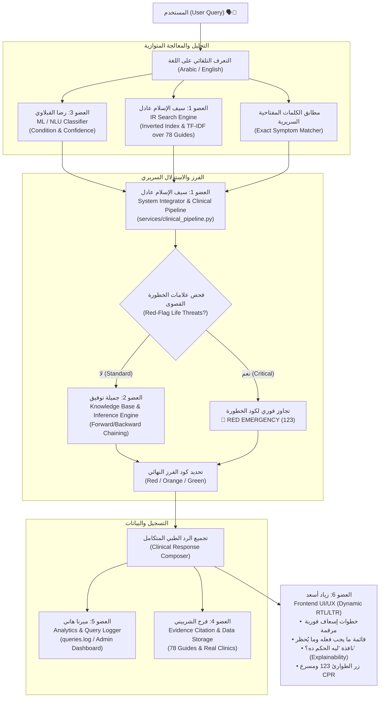

# 🚑 VENOM — منظومة الإسعاف والتوجيه الطبي الفوري
### AI-Powered Clinical First Aid Triage, Emergency Guidance & Decision Support System

[](https://www.python.org/)
[](https://flask.palletsprojects.com/)
[](https://scikit-learn.org/)
[](https://web.dev/progressive-web-apps/)
[](#-منظومة-الاختبارات-وجودة-الكود-test-suite)
[](https://oop-venom.vercel.app)

---

## 🌐 الروابط الرسمية للمشروع (Live Links)

* 🚀 **رابط المنظومة لايف (Live Production):** [https://oop-venom.vercel.app](https://oop-venom.vercel.app)
* 💬 **المساعد الإسعافي الذكي (Bilingual Chatbot):** [https://oop-venom.vercel.app/pages/chat.html](https://oop-venom.vercel.app/pages/chat.html)
* 🩺 **نظام الفرز السريري الشجري (Clinical Triage):** [https://oop-venom.vercel.app/pages/triage.html](https://oop-venom.vercel.app/pages/triage.html)
* 🏥 **دليل المستشفيات وأقرب نقطة إسعاف (GPS Hospitals):** [https://oop-venom.vercel.app/pages/contacts.html](https://oop-venom.vercel.app/pages/contacts.html)
* 🫀 **مسرع الإنعاش القلبي الرئوي وتعلّم الإسعاف (CPR Metronome):** [https://oop-venom.vercel.app/pages/learn.html](https://oop-venom.vercel.app/pages/learn.html)
* 🔐 **لوحة الإدارة والمراقبة والتحليلات (Admin Panel):** [https://oop-venom.vercel.app/admin](https://oop-venom.vercel.app/admin)
* 📦 **مستودع الكود (GitHub Repository):** [https://github.com/saifadel20071234-sudo/oop-_-venom](https://github.com/saifadel20071234-sudo/oop-_-venom)

---

## 📌 نبذة عامة عن المشروع (Project Overview)

تعتبر الدقائق الخمس الأولى عقب وقوع الحوادث المفاجئة (مثل توقف القلب، النزيف الشرياني الحاد، الاختناق، أو الحروق الكيميائية) هي **"النافذة الذهبية" (Golden Window)** التي تفصل بين النجاة والوفاة.

مشروع **VENOM (مسعف الذكي)** هو منظومة إسعاف وتوجيه طبي متقدمة صُممت وفق معايير هندسة البرمجيات والذكاء الاصطناعي السريري، وتجمع بين:
1. **استرجاع المعلومات المعتمدة (Information Retrieval - IR):** فهرس معكوس مخصص ومعادلات TF-IDF للبحث في 78 دليلاً طبياً معتمداً.
2. **محرك الاستدلال والفرز المنطقي (Knowledge Base & Inference Engine):** خوارزميات الاستدلال الأمامي والعكسي (Forward/Backward Chaining) لتحديد درجة الخطورة السريرية (🔴 أحمر - 🟠 برتقالي - 🟢 أخضر).
3. **التعلم الآلي وفهم اللغة الطبيعية (ML / NLU):** نموذج ذكاء اصطناعي لتصنيف النوايا بدقة وكشف لغة المستخدم تلقائياً (عربي / إنجليزي).
4. **التطبيق التقدمي الداعم للعمل أوفلاين (PWA & Offline-First):** إمكانية العمل بكفاءة تامة 100% بدون اتصال بالإنترنت في المناطق النائية وحالات انقطاع الشبكات.

---

## 👥 فريق العمل ومصفوفة المسؤوليات (Team Matrix)

> **ملاحظة:** أعضاء الفريق متساوون في المسؤولية والمساهمة البرمجية كفريق عمل متكامل (Peer Engineering Team)، حيث طوّر كل عضو وحدة تقنية متخصصة ومستقلة ترتبط بالمنظومة المركزية:

| العضو | الاسم | الدور البرمجي والمسؤولية التقنية المباشرة | المخرجات البرمجية الرئيسية المسلّمة |
| :---: | :--- | :--- | :--- |
| **01** | **سيف الإسلام عادل** | **IR Search Engine & System Architecture Lead**<br>*(محرك استرجاع المعلومات + مسؤول ربط وتكامل كافة أجزاء المشروع ببعضها)* | • بناء محرك البحث الكامل من الصفر (Inverted Index + TF-IDF + Cosine Similarity)<br>• تصميم عقود التكامل الموحدة للنظام (`contracts.py`)<br>• هندسة وتطوير خط الأنابيب السريري الموحد (`services/clinical_pipeline.py`) وربط وحدات كافة الأعضاء<br>• ضبط وإدارة مستودع Git والربط السحابي مع Vercel |
| **02** | **جميلة توفيق** | **Knowledge Base & Clinical Inference Engine Lead**<br>*(قواعد المعرفة الطبية ومحرك الاستدلال والفرز السريري)* | • بناء قاعدة المعرفة الطبية وشجرة الفرز (`rules.json`, `facts.json`)<br>• تنفيذ خوارزميات الاستدلال المنطقي (Forward & Backward Chaining)<br>• تطوير موديول تفسير القرارات الطبية بشفافية (*Explanation Facility: "ليه الحكم ده؟"* )<br>• التحقق من صحة القواعد السريرية ومنع التعارضات الطبية (`kb/validator.py`) |
| **03** | **رضا القبلاوي** | **Machine Learning & Natural Language Understanding Lead**<br>*(تعلم الآلة، معالجة اللغات الطبيعية وإدارة الحوار الذكي)* | • تدريب وتقييم نموذج تصنيف الحالات الطارئة (`nlu/classifier.py`)<br>• موديول التعرف التلقائي على اللغة (عربي / إنجليزي) (`nlu/language_detect.py`)<br>• استخراج النوايا والأعراض السريرية بدقة وحساب نسبة الثقة (Confidence Scoring)<br>• ضبط حواجز الأمان ومنع الهلوسة في الردود (`chatbot/guardrails.py`) |
| **04** | **فرح الشربيني** | **Clinical Data Engineering & File Handling Lead**<br>*(هندسة البيانات الطبية، إدارة وتخزين الملفات)* | • تجميع وتدقيق 78 دليلاً طبياً إسعافياً معتمداً من WHO ووزارة الصحة المصرية (`data/guides/`)<br>• إعداد وتدقيق قاعدة بيانات العيادات والمستشفيات (304 عيادة في `data/clinics.csv`)<br>• بناء دوال التخزين والحفظ الذري للملفات وحماية البيانات من التلف (`storage/storage.py`)<br>• إدارة ومعالجة ملفات التدريب وحالات الطوارئ (`data/training_data.csv`) |
| **05** | **ميرنا هاني** | **Backend APIs, Admin Dashboard & Analytics Lead**<br>*(خادم الـ Backend، مسارات RESTful APIs، ولوحة الإدارة والتحليلات)* | • تطوير مسارات خادم Flask وتأمين الـ RESTful Endpoints (`routes/`)<br>• بناء وتأمين لوحة تحكم الإدارة الشاملة بنظام الجلسات المشفرة (`/admin`)<br>• تسجيل وتتبع استعلامات المستخدمين وتحليل سرعة الاستجابة (`logs/queries.log`)<br>• لوحة الإحصائيات الحية ورسم بياني لمؤشرات الحالات الطارئة (`static/js/admin.js`) |
| **06** | **زياد أسعد** | **Frontend UI/UX & PWA Architecture Lead**<br>*(تصميم وتطوير واجهات المستخدم التفاعلية والويب التقدمي PWA)* | • هندسة وتصميم واجهات الويب التقدمية (PWA) المتجاوبة بالكامل لجميع الشاشات<br>• بناء وتفعيل مشغل الخدمة للعمل بدون إنترنت نهائياً (`sw.js` Cache Strategy)<br>• تطوير المجسم التشريحي التفاعلي 3D ومسرع الإنعاش الصوتي/البصري (CPR Metronome)<br>• ربط واجهة المحادثة التفاعلية وتطبيق محاذاة اللغات (RTL / LTR) وعناصر تقييم الردود |

---

## 🏗️ المعمارية التقنية للمنظومة (System Architecture & Pipeline)

يعتمد النظام على بنية **الاسترجاع المدعوم بالمعرفة (Knowledge-Augmented Clinical Decision Pipeline)**، حيث تتكامل وحدات الفريق في خط إنتاج سريري فوري ودقيق:



---

## ✨ المميزات والخصائص الفريدة للمنظومة

### 1. الدعم الثنائي الكامل للغتين (Full Bilingual Support 🇸🇦 🇬🇧)
* فحص تلقائي لحظي للغة الاستعلام (عربي أو إنجليزي).
* عند الكتابة بالإنجليزية، يتم تحويل الاستجابة بالكامل للإنجليزي:
  * العنوان الطبي والتصنيف السريري المعتمد.
  * 5 خطوات إسعاف فورية مرقمة (*Actionable Emergency Steps*).
  * قائمة المحظورات والإجراءات الصحيحة (*What to DO & What NOT to do*).
  * اتجاه الواجهة من اليسار لليمين (`dir="ltr"`) وتحديث كافة أزرار التفاعل (`Why this decision?`, `Medical Citation:`, `Critical Emergency`).

### 2. محرك استرجاع المعلومات الطبي من الصفر (IR Engine from Scratch)
* لا يعتمد على مكتبات جاهزة للبحث مثل Lucene أو Whoosh.
* مطبّق بالكامل يدويًا بلغة Python:
  * **معالجة النصوص (Preprocessing):** تطبيع الألف والتاء المربوطة، إزالة التشكيل، استبعاد كلمات الوقف (Stopwords)، وتقطيع النصوص (Tokenization).
  * **الفهرس المعكوس (Inverted Index):** تخزين الكلمات ومواقعها وأوزانها داخل ملف JSON سريع التحميل.
  * **معادلات TF-IDF والتشابه الجيبي (Cosine Similarity):** حساب الأوزان النسبية وترتيب نتائج الأدلة الـ 78 طبياً.

### 3. محرك الاستدلال وشجرة الفرز السريري (Inference & Triage Engine)
* تطبيق بروتوكولات الفرز المعتمدة (Manchester Triage System & Emergency Severity Index).
* دعم الاستدلال الأمامي (Forward Chaining) لاكتشاف الحالات بالحقائق، والاستدلال العكسي (Backward Chaining) للتحقق من الفرضيات.
* **نافذة الشفافية والتعليل ("ليه الحكم ده؟"):** شرح منطقي يوضح للمسعف أسباب اختيار كود الخطورة والخطوات المقترحة.

### 4. التجاوز الطارئ الفوري (Red-Flag Emergency Priority Override)
* عند التقاط أعراض مهددة للحياة (توقف التنفس، فقدان النبض، غيبوبة، اشتباه جلطة أو ذبحة، نزيف شرياني، أو اختناق):
  * يتجاوز النظام أي احتمالات أخرى فوراً ويُصنف الحالة كـ **🔴 طوارئ قصوى (RED)**.
  * إطلاق تنبيه صوتي عاجل عبر Web Audio API.
  * إبراز زر الاتصال بالإسعاف (123) مباشرة بنقرة واحدة.

### 5. نظام تحديد المستشفيات وأقرب نقطة إسعاف حي (GPS Hospital Locator)
* قاعدة بيانات حقيقية تضم **304 مستشفى وعيادة ومركز صحي** بمحافظة كفر الشيخ والدلتا.
* كل عيادة مزودة بإحداثيات جغرافية دقيقة (Latitude & Longitude).
* حساب المسافة المباشرة بين المستخدم وكل مستشفى باستخدام معادلة هافرسين الكروية (**Haversine Great-Circle Formula**):
  $$\Delta\sigma = 2 \arcsin \left( \sqrt{\sin^2\left(\frac{\Delta\phi}{2}\right) + \cos(\phi_1)\cos(\phi_2)\sin^2\left(\frac{\Delta\lambda}{2}\right)} \right)$$
* فرز وتصنيف أقرب المستشفيات لموقع المستخدم الحقيقي لحظياً، مع إتاحة الاتصال الهاتفي ورابط خرائط Google لكل مستشفى.

### 6. مسرع الإنعاش القلبي الرئوي (Interactive CPR Metronome)
* مؤقت ونبضات سمعية وبصرية حيّة بمعدل **110 نبضة في الدقيقة (BPM)** وفق معايير جمعية القلب الأمريكية (AHA).
* يساعد المسعف على ضبط عمق وتوقيت ضغطات الصدر بدقة حتى وصول سيارة الإسعاف.

### 7. العمل أوفلاين بنسبة 100% (Offline-First PWA)
* تثبيت كامل كـ Progressive Web App على هواتف Android و iPhone وأجهزة الحاسوب.
* مشغل خدمة متقدم (`sw.js`) يقوم بتخزين كافة الأصول والواجهات والمصادر محلياً.

### 8. لوحة الإدارة ومراقبة التحليلات (Admin & Clinical Analytics)
* واجهة إدارة آمنة ومحمية بكلمة مرور وجلسات مشفرة ومضادة لثغرات CSRF.
* مراقبة مباشرة لسجلات البحث (`search_logs.csv` & `queries.log`).
* رسم بياني تفاعلي ومؤشرات إحصائية لأكثر الحالات تكراراً ومتوسط سرعة استجابة السيرفر.
* لوحة تحكم كاملة لإضافة وتعديل وحذف العيادات، أرقام الطوارئ، وقواعد الفرز الطبي.

---

## 📁 الهيكل التنظيمي للمستودع (Repository Structure)

```
oop-_-venom/
├── app.py                         ← السيرفر الرئيسي الموحد لمنظومة Flask
├── auth.py                        ← نظام المصادقة وحماية لوحة الإدارة
├── config.py                      ← إعدادات ومسارات النظام المشتركة
├── contracts.py                   ← عقود التكامل البرمجية الموحدة بين أعضاء الفريق
├── requirements.txt               ← متطلبات وبيئة التشغيل بلغة Python
├── vercel.json                    ← ملف تكوين وإعدادات النشر السحابي على Vercel
├── render.yaml                    ← إعدادات الاستضافة البديلة على Render
│
├── api/                           ← مسارات التخديم السحابي (Serverless Entrypoint)
│   └── index.py                   ← نقطة انطلاق WSGI لبيئة Vercel
│
├── ir/                            ← [العضو 1: سيف الإسلام عادل] محرك استرجاع المعلومات
│   ├── inverted_index.py          ← بناء وهيكلة الفهرس المعكوس
│   ├── tfidf.py                   ← حساب مصفوفة TF-IDF ومعادلات Cosine Similarity
│   ├── searcher.py                ← محرك الاستعلام والترتيب الطبي
│   ├── preprocessor.py            ← تطبيع وتنظيف واستبعاد كلمات الوقف
│   ├── synonyms.py                ← معجم المرادفات والمصطلحات الطبية
│   └── evaluator.py               ← تقييم دقة الاسترجاع (Precision & Recall)
│
├── kb/                            ← [العضو 2: جميلة توفيق] قاعدة المعرفة والاستدلال
│   ├── knowledge_base.py          ← إدارة وتحميل قواعد المعرفة الطبية
│   ├── inference_engine.py        ← محرك الاستدلال الأمامي والعكسي
│   ├── explainer.py               ← موديول تعليل وتفسير القرارات السريرية
│   ├── validator.py               ← فحص تكامل القواعد ومنع التضارب
│   └── special_cases.py           ← المعالجة الخاصة لحالات الحمل والأطفال وكبار السن
│
├── nlu/                           ← [العضو 3: رضا القبلاوي] تعلم الآلة ومعالجة اللغات
│   ├── classifier.py              ← تدريب ونمذجة مصنف الحالات الطارئة
│   ├── predictor.py               ← التنبؤ بالحالة ونسبة الثقة
│   ├── language_detect.py         ← كاشف لغة المستخدم (عربي / إنجليزي)
│   └── preprocessor_ml.py         ← تحضير المتجهات النصية للنموذج
│
├── chatbot/                       ← [العضو 3: رضا القبلاوي] إدارة الحوار الذكي
│   ├── dialog_manager.py          ← إدارة جلسات المحادثة واستقبال المدخلات
│   ├── response_composer.py       ← بناء قوالب الردود المتوازنة
│   ├── guardrails.py              ← حواجز الأمان الطبية لمنع الإجابات الخطرة
│   └── templates.py               ← النصوص القياسية للردود
│
├── data/                          ← [العضو 4: فرح الشربيني] البيانات والمراجع السريرية
│   ├── guides/                    ← 78 دليلاً طبياً معتمداً بصيغة TXT
│   ├── clinics.csv                ← قاعدة بيانات 304 عيادة ومستشفى بإحداثيات GPS
│   ├── contacts.csv               ← دليل أرقام الطوارئ السريعة بالجمهورية
│   ├── rules.json                 ← قواعد الاستدلال والفرز السريري
│   ├── facts.json                 ← حقائق الحالات والأعراض السريرية
│   ├── training_data.csv          ← بيانات تدريب واختبار نموذج الذكاء الاصطناعي
│   └── search_logs.csv            ← سجلات الاستعلامات والبحث
│
├── storage/                       ← [العضو 4: فرح الشربيني] موديول التخزين الآمن
│   └── storage.py                 ← دوال الحفظ الذري وقراءة ملفات البيانات
│
├── routes/                        ← [العضو 5: ميرنا هاني] مسارات الـ RESTful APIs
│   ├── chatbot_routes.py          ← مسار الشات الطبي الذكي (/api/chat)
│   ├── search_routes.py           ← مسار محرك البحث السريري (/api/search)
│   ├── triage_routes.py           ← مسار استبيان الفرز التفاعلي (/api/triage)
│   ├── clinics_routes.py          ← مسار بيانات المستشفيات والـ GPS (/api/clinics)
│   ├── contacts_routes.py         ← مسار أرقام الطوارئ (/api/contacts)
│   ├── dashboard_routes.py        ← مسارات لوحة الأدمن والتحليلات (/admin)
│   └── analytics_routes.py        ← مسار سجلات ومؤشرات الأداء (/api/analytics)
│
├── services/                      ← طبقة الخدمات البرمجية والتكامل المشترك
│   ├── clinical_pipeline.py       ← [العضو 1: سيف الإسلام عادل] خط الأنابيب السريري الموحد
│   ├── search_service.py          ← خدمة إدارة عمليات البحث والربط
│   ├── clinics_service.py         ← خدمة إدارة ومعالجة بيانات العيادات
│   ├── contact_service.py         ← خدمة جهات الاتصال والطوارئ
│   └── analytics_service.py       ← خدمة تجميع وتحليل البيانات الإحصائية
│
├── frontend/                      ← [العضو 6: زياد أسعد] واجهات المستخدم والـ PWA
│   ├── index.html                 ← الشاشة الرئيسية وتجربة الطوارئ
│   ├── manifest.json              ← ملف تعريف تطبيق الويب التقدمي (PWA)
│   ├── sw.js                      ← مشغل الذاكرة المخبأة والعمل أوفلاين (Service Worker)
│   ├── css/                       ← أنماط التنسيق ودعم الوضع الليلي والداكن
│   ├── js/                        ← منطق العرض وتفاعل الواجهات والـ GPS والمحادثة
│   ├── components/                ← مكونات الويب القابلة لإعادة الاستخدام (Badges, Steps)
│   └── pages/                     ← الصفحات الفرعية (chat, triage, contacts, learn)
│
├── static/                        ← أصول لوحة تحكم الإدارة (CSS, JS)
├── templates/                     ← قوالب صفحات الإدارة ولوحة المراقبة (`admin.html`)
│
└── tests/                         ← حزمة اختبارات التكامل الشاملة (69 Tests)
    ├── test_clinical_pipeline.py  ← اختبارات خط الأنابيب الذكي والدعم الثنائي للغات
    ├── test_ir.py                 ← اختبارات الفهرس المعكوس و TF-IDF
    ├── test_kb.py                 ← اختبارات قواعد الاستدلال والفرز
    ├── test_ml_nlu.py             ← اختبارات مصنف الذكاء الاصطناعي وكاشف اللغة
    ├── test_storage.py            ← اختبارات عمليات التخزين والحفظ الذري
    ├── test_api.py                ← اختبارات الـ REST Endpoints
    └── test_unified_server.py     ← اختبارات خادم Flask المتكامل
```

---

## 🚀 طريقة التثبيت والتشغيل المحلي (Quick Start Guide)

### 1. المتطلبات الأساسية
* بيئة **Python 3.10** أو أحدث مثبتة على جهازك.
* مدير الحزم **pip**.
* أداة **Git**.

### 2. استنساخ المستودع (Clone)
```bash
git clone https://github.com/saifadel20071234-sudo/oop-_-venom.git
cd oop-_-venom
```

### 3. إنشاء البيئة الافتراضية وتفعيلها (Virtual Environment)
* **على نظام Windows (PowerShell):**
  ```powershell
  python -m venv .venv
  .\.venv\Scripts\Activate.ps1
  ```
* **على نظام Linux / macOS:**
  ```bash
  python3 -m venv .venv
  source .venv/bin/activate
  ```

### 4. تثبيت الحزم والمكتبات المطلوبة
```bash
pip install -r requirements.txt
```

### 5. إعداد ملف البيئة والمتغيرات (`.env`)
قم بنسخ ملف `.env.example` إلى `.env`:
```powershell
Copy-Item .env.example .env
```
أو على أنظمة Linux/macOS:
```bash
cp .env.example .env
```
ثم قم بتعيين كلمة مرور الأدمن ومفتاح التشفير داخل `.env`:
```env
ADMIN_PASSWORD=your_secure_password
FLASK_SECRET_KEY=your_secret_key_here
APP_ENV=development
```

### 6. تشغيل السيرفر المحلي
```bash
python app.py
```
سيبدأ الخادم بالعمل على الرابط:
👉 **[http://127.0.0.1:5000](http://127.0.0.1:5000)**

---

## 🧪 منظومة الاختبارات وجودة الكود (Test Suite)

تتضمن المنظومة **69 اختبار تكامل ووحدة (Integration & Unit Tests)** تغطي كافة طبقات النظام من استرجاع المعلومات، الاستدلال، الذكاء الاصطناعي، خط الأنابيب السريري، ونقاط اتصال الخادم.

لتشغيل الاختبارات بالكامل والتأكد من سلامة النظام:
```bash
python -m unittest discover tests
```

**مخرجات التشغيل الفعلية:**
```text
Ran 69 tests in 10.324s

OK
```

---

## 📡 وثائق نقاط الاتصال البرمجية (REST API Reference)

| المسار (Endpoint) | الطريقة (Method) | الوصف والمهمة | المدخلات (Payload) | المخرجات (Response) |
| :--- | :---: | :--- | :--- | :--- |
| `/api/chat` | `POST` | معالجة استعلام المستخدم عبر خط الأنابيب السريري المتكامل (عربي/إنجليزي) | `{"message": "عندي حرق بمية مغلية", "session_id": "optional"}` | كائن سريري غني يشتمل على كود الخطورة، الخطوات المرقمة، المحظورات، المرجع، والتعليل |
| `/api/predict` | `POST` | التنبؤ بالحالة الطبية واللغة عبر نموذج الـ ML / NLU | `{"text": "severe chest pain"}` | `{"condition": "chest_pain_cardiac", "confidence": 0.95, "language": "english"}` |
| `/api/triage` | `POST` | تقييم إجابات الفرز الشجري عبر محرك الاستدلال KB | `{"category": "burns", "symptoms": ["درجة ثانية", "فقاقيع"]}` | درجة الخطورة (Severity) وقواعد الاستدلال التي تم تفعيلها |
| `/api/search` | `GET/POST` | استعلام محرك البحث السريري IR عبر الـ Inverted Index | `{"query": "بلع مادة كاوية", "k": 3}` | قائمة بأعلى الأدلة السريرية تطابقاً مع نسبة التشابه ومقتطفات الأدلة |
| `/api/clinics` | `GET` | جلب قائمة الـ 304 عيادة ومستشفى بإحداثيات الـ GPS | لا يوجد | مصفوفة المستشفيات مع الأسماء، العناوين، الهواتف، وخطوط الطول والعرض |
| `/api/contacts` | `GET` | جلب دليل أرقام الطوارئ السريعة المعتمدة | لا يوجد | أرقام الإسعاف (123)، النجدة (122)، المطافئ (180)، وطوارئ السموم |
| `/api/analytics` | `GET` | إحصائيات الاستعلامات وتوزيع الحالات (يتطلب مصادقة) | لا يوجد | إحصائيات دقيقة لمعدل الاستعلامات ومؤشرات الأداء وزمن الاستجابة |

---

## ⚖️ إخلاء المسؤولية الطبية والقانونية (Medical & Legal Disclaimer)

> **⚠️ تنبيه طبي هام:**
> تم تطوير مشروع **VENOM (مسعف الذكي)** لأغراض التوعية الصحية، التوجيه السريع، والدعم السريري المبدئي فقط وفق بروتوكولات الإسعاف الأولي المعتمدة دولياً (*American Heart Association & European Resuscitation Council*). **هذا النظام لا يُعد بديلاً عن الفحص الطبي المتخصص أو التشخيص السريري البشري**. في حالات الطوارئ الحرجة والمهددة للحياة، يجب فوراً ودون تأخير **الاتصال بهيئة الإسعاف المصرية على الرقم الموحد (123)** أو التوجه مباشرة لأقرب قسم طوارئ واستقبال بمستشفى حكومي أو جامعي.

---

## 📄 الترخيص (License)

هذا المشروع مطوّر ومتاح للأغراض الأكاديمية والتعليمية وخدمة المجتمع تحت مظلة رخصة **MIT License**.
حقوق التطوير والملكية الفكرية محفوظة لفريق عمل **VENOM © 2026**.
